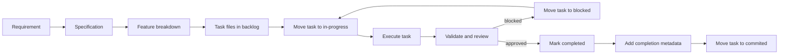

# Agent Workflow and Task Versioning

## Purpose

Define how agents turn requirements into executable work, how progress is tracked, and how completed task records are preserved.

## Working directories

```text
board/
  backlog/      # approved features and tasks waiting to start
  in-progress/  # tasks currently being executed
  blocked/      # tasks stopped by an external dependency or decision
  commited/     # completed task records; preserve the requested folder name

docs/
  specifications/  # approved product and technical specifications
  templates/       # reusable document templates
```

The workflow is file-based and repository-versioned. The task Markdown file is the source of truth for task status and completion evidence.

## Lifecycle



## Step 1: Raise and clarify requirements

The Product or Specification agent must:

1. capture the problem and expected outcome;
2. identify actors, constraints, assumptions, and risks;
3. define scope and out of scope;
4. write testable acceptance criteria;
5. identify functional and non-functional requirements;
6. record open questions and decisions.

An unclear requirement must not become an implementation task. It remains in specification work until the missing decision is resolved.

## Step 2: Create features

A specification groups related requirements into features. Each feature must have:

- a stable feature ID, such as `FEAT-001`;
- a user or system outcome;
- scope and exclusions;
- dependencies;
- acceptance criteria;
- relevant risks and non-functional requirements.

Use vertical slices when possible. A feature should represent a meaningful outcome, not a technical layer alone.

## Step 3: Generate tasks

When a specification is approved, the Specification agent must split every feature into task files. A task should be:

- small enough for one focused implementation and review;
- owned by one role;
- independently testable;
- explicit about inputs, outputs, dependencies, and validation;
- linked to its feature and source specification.

Typical task categories include:

- architecture and decision records;
- domain and application logic;
- API and contract work;
- frontend work;
- database and migration work;
- infrastructure and deployment;
- security hardening;
- tests and quality gates;
- documentation and release.

Do not create one task per file. Create tasks around outcomes and acceptance criteria. A task may touch multiple files when that is necessary for one coherent outcome.

## Task file naming

Use the pattern:

```text
TASK-<number>-<short-kebab-case-title>.md
```

Examples:

```text
TASK-001-create-domain-contract.md
TASK-002-add-api-validation.md
```

Task IDs are immutable. If the task changes scope, update the task record and add a decision note rather than reusing the ID for unrelated work.

## Task status rules

Allowed statuses:

- `backlog`: ready but not started;
- `in-progress`: actively being executed;
- `blocked`: cannot proceed because of an external dependency or unresolved decision;
- `review`: implementation exists and awaits validation or review;
- `completed`: acceptance criteria met and evidence recorded;
- `cancelled`: intentionally stopped with a reason.

The file location must match the status:

| Status        | Directory            |
| ------------- | -------------------- |
| `backlog`     | `board/backlog/`     |
| `in-progress` | `board/in-progress/` |
| `blocked`     | `board/blocked/`     |
| `review`      | `board/in-progress/` |
| `completed`   | `board/commited/`    |
| `cancelled`   | `board/commited/`    |

The spelling `commited` is intentional because it is the requested folder name. Do not silently replace it with `committed`.

## Starting a task

Before implementation:

1. read the linked specification and dependencies;
2. confirm the acceptance criteria are actionable;
3. assign the responsible role or agent;
4. set `status: in-progress`;
5. add `startedAt` in ISO 8601 format;
6. move the task file from `board/backlog/` to `board/in-progress/`;
7. record the planned validation command or evidence.

The move and metadata change must be part of the same version-controlled change whenever practical.

## Executing a task

The assigned agent must:

1. work only within the task scope unless the task is updated;
2. keep the task status accurate;
3. record decisions, deviations, and blockers;
4. add or update tests;
5. run the specified validation;
6. report changed files and residual risks.

If scope changes materially, stop and update the task or create a new task. Do not hide scope expansion in implementation details.

## Completing a task

A task can be completed only when:

- every acceptance criterion is satisfied;
- required tests and checks pass;
- review findings are resolved or explicitly accepted;
- documentation and migration notes are updated when needed;
- no unresolved blocker remains;
- completion evidence is recorded in the task file.

Before moving the file, update its frontmatter:

```yaml
status: completed
completedAt: "YYYY-MM-DDTHH:mm:ssZ"
completedBy: "role-or-agent-id"
commit: "<version-control-commit-id>"
validation:
  - "<command or evidence>"
```

Then move the task file to `board/commited/`. The completed file must remain immutable in meaning: corrections may add an amendment section, but must not erase the original completion evidence.

## Versioning rules

Version the work at three levels:

1. **Task identity:** immutable `taskId` and `featureId`.
2. **Task history:** Git or the repository version-control system records file moves and content changes.
3. **Completion evidence:** completion timestamp, responsible agent, commit identifier, validation, and review reference.

If a completed task needs follow-up work, create a new task with a new ID and link it using `supersedes`, `amends`, or `dependsOn`. Do not reopen a completed task unless the team explicitly decides that the original completion was invalid.

## Blocked tasks

When blocked:

1. set `status: blocked`;
2. record `blockedAt`, `blockedBy`, and the exact missing decision or dependency;
3. add an unblock condition;
4. move the file to `board/blocked/`;
5. create or link a decision task when needed.

A blocked task must not be reported as completed.

## Review handoff

Before completion, the task moves through the appropriate review agents:

- Reviewer checks correctness, regressions, architecture, and test gaps;
- QA checks acceptance criteria and behavior;
- Hardening checks security and abuse cases;
- Code Quality checks lint, format, type safety, and maintainability;
- Infrastructure or DevOps checks operational impact when applicable.

Not every task requires every reviewer, but the task file must state which reviews were required and their results.

## Required reporting

Every task update should state:

- current status;
- work completed since the previous update;
- remaining work;
- blockers or risks;
- validation performed;
- next action.

## Completion checklist

- [ ] Task ID and feature ID are stable.
- [ ] Scope and dependencies are explicit.
- [ ] Acceptance criteria are testable.
- [ ] Responsible agent is recorded.
- [ ] Implementation is complete.
- [ ] Tests and quality checks passed.
- [ ] Required reviews are complete.
- [ ] Documentation and migrations are addressed.
- [ ] Completion metadata is present.
- [ ] Task file was moved to `board/commited/`.
