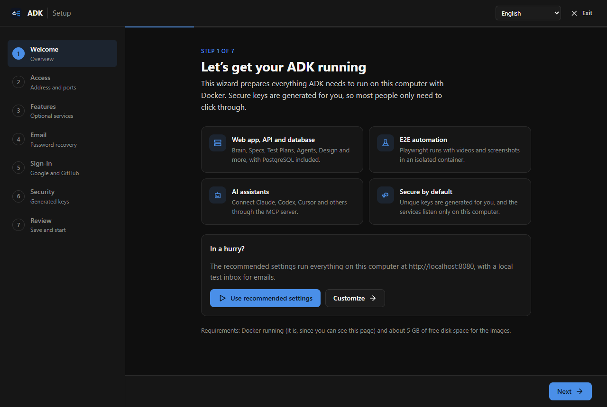

# ADK — Agent DevKit

[](https://github.com/lucaseduardocrp/agent-devkit/actions/workflows/ci.yml)
[](https://github.com/lucaseduardocrp/agent-devkit/actions/workflows/codeql.yml)
[](https://scorecard.dev/viewer/?uri=github.com/lucaseduardocrp/agent-devkit)

ADK is a QA and product-delivery platform driven by AI assistants. It brings together a knowledge
base, specifications, test plans, agents, design prototypes and E2E automation in shared
workspaces, and exposes all of it to Claude, Codex and other assistants through an MCP server.

## Quick start

All you need is [Docker Desktop](https://www.docker.com/products/docker-desktop/) (or Docker
Engine with Compose v2) and about 5 GB of free disk space. Nothing else is installed on your
computer: the database, the API, the web app, the E2E worker, the MCP server and the test inbox
all run in containers. No terminal is needed.

1. **Download ADK**: `git clone https://github.com/lucaseduardocrp/agent-devkit.git`, or use
   **Code → Download ZIP** on GitHub and extract it.
2. **Double-click the launcher** in the ADK folder:

   | Windows   | macOS         | Linux                         |
   | --------- | ------------- | ----------------------------- |
   | `adk.cmd` | `ADK.command` | `adk.sh` (or run `./adk.sh`) |

   If Docker Desktop is installed but closed, the launcher opens it and waits for it; if it is
   not installed, the launcher opens the download page. On macOS, a copy downloaded as a ZIP may
   need **right-click → Open** the first time.

3. **Configure it in your browser.** The setup wizard opens by itself at `http://localhost:4000`.
   Secure keys are generated for you, so the defaults are enough: click **Use recommended
   settings**, then **Save and start ADK**. The page follows the startup and shows the link to
   ADK when it is ready (the first start builds the images and takes 5 to 15 minutes).



Then open `http://localhost:8080`, create your account and your first workspace, and connect your
assistant to the MCP server at `http://localhost:3333/mcp` (see
[Using ADK from an AI assistant](#using-adk-from-an-ai-assistant)).

From then on, double-clicking the launcher starts ADK in seconds. To stop it without a terminal,
use the **Containers** screen of Docker Desktop: the `agent-devkit` group has stop and start
buttons, and your data is kept.

**Testing apps on your computer.** Integration, load and E2E tests of `http://localhost:<port>`
reach the apps running on this computer, even though the tests run in containers: requests keep
`Host: localhost` and the browser keeps the localhost origin, so dev servers, cookies, CORS and
sign-in work as in your own browser. This is on while ADK is reachable from this computer only;
allowing access from other devices in the wizard turns it off, so a shared server never exposes
the services of the machine it runs on.

### Everyday commands

| What                                   | Windows        | macOS / Linux      |
| -------------------------------------- | -------------- | ------------------ |
| Start ADK                              | `adk.cmd`      | `./adk.sh`         |
| Change the configuration (wizard)      | `adk setup`    | `./adk.sh setup`   |
| Stop ADK (your data is kept)           | `adk stop`     | `./adk.sh stop`    |
| Follow the logs                        | `adk logs`     | `./adk.sh logs`    |
| See the services and their health      | `adk status`   | `./adk.sh status`  |
| Update to the latest version           | `adk update`   | `./adk.sh update`  |

The launchers are thin wrappers around Docker Compose. Without them: run
`docker compose -f setup/compose.yaml up`, finish the wizard at `http://localhost:4000`, then
`docker compose up -d --build`.

### What runs

| Service    | Address                      | Notes                                                   |
| ---------- | ---------------------------- | ------------------------------------------------------- |
| Web app    | `http://localhost:8080`      | Always on                                               |
| API        | `http://localhost:3000`      | Always on; applies database migrations when it starts   |
| PostgreSQL | internal only                | Always on; data lives in the `agent-devkit_database-data` volume |
| Redis      | internal only                | Always on; read cache, keeps nothing on disk            |
| E2E worker | internal only                | On by default: Playwright and Chromium (about 2 GB); also runs integration and load tests |
| MCP server | `http://localhost:3333/mcp`  | On by default: MCP for Claude Code, Codex, VS Code and other assistants |
| Mailpit    | `http://localhost:8025`      | On by default: local inbox that catches password-recovery emails |

The recommended settings turn on every service; the wizard can turn the E2E worker, the MCP
server and Mailpit off.

Every port, the services to run, email (SMTP), Google and GitHub sign-in, video storage and
access from other devices are set in the wizard and saved to `.env` in the ADK folder. Keep a
copy of that file: its `INTEGRATION_ENCRYPTION_KEY` is needed to read saved integrations.
The [self-hosting guide](docs/self-hosting.md) covers HTTPS, backups, upgrades and
troubleshooting.

## Deploy on Railway

[](https://railway.com/deploy/agent-devkit)

The button creates a complete ADK in your Railway account: PostgreSQL, Redis, the API, the web
app, the remote MCP server and the test worker (E2E, integration and load), with every secret
generated and the services connected over Railway's private network. When the deploy finishes:

1. Open the `Web` service's URL and create your account and first workspace.
2. Connect your assistant to `https://<MCP service URL>/mcp` (claude.ai, Claude Code, Codex and
   other MCP clients sign in through OAuth). The CLI is optional:
   `npm install -g @agent-devkit/cli`, then `devkit login --api-url https://<API service URL>`.
3. Optional: set `SMTP_URL` on the `API` service for password-recovery emails, and the Google or
   GitHub OAuth variables for social sign-in.

The services, variables and how the template is maintained are documented in
[docs/deploy/railway.md](docs/deploy/railway.md).

## Using ADK from an AI assistant

With ADK running on your computer, point your assistant to the MCP server in its container,
`http://localhost:3333/mcp`; it asks you to sign in to ADK the first time. Nothing has to be
installed:

- **Claude Code:** `claude mcp add --transport http adk http://localhost:3333/mcp`, then `/mcp`.
- **VS Code, Cursor and other MCP clients:** add an HTTP server with that URL in their MCP
  settings.
- **Codex:** `url = "http://localhost:3333/mcp"` under `[mcp_servers.adk]`, with an access token
  from your ADK profile in `bearer_token_env_var`.

claude.ai on the web reaches only public addresses, so it needs ADK behind a public HTTPS URL
(see the [self-hosting guide](docs/self-hosting.md)).

The CLI is optional. It installs the ADK skills in your assistant's skills folder, runs E2E tests
in a browser on your desktop and opens tunnels to share local apps with a remote ADK:

```bash
npm install -g @agent-devkit/cli
devkit login --api-url http://localhost:3000   # or the address of your ADK API
```

`devkit` registers the MCP server with Claude Code, Claude Desktop, Codex, Cursor, Gemini CLI,
VS Code and other MCP clients. In host mode no LLM API key is needed: your assistant does the
reasoning and ADK supplies context and stores the results. The CLI also runs E2E tests in your
local browser (`devkit runner`) and opens tunnels to local apps (`devkit bridge`). The CLI is
documented in [apps/Cli/README.md](apps/Cli/README.md) and the MCP server (clients, remote mode,
tools) in [apps/Mcp/README.md](apps/Mcp/README.md).

## Features

- **Brain**: workspace knowledge base with document relations, search and grounded answers.
- **Specs**: specification drafting, templates and section-by-section editing.
- **Test Plans**: test plan and suite generation, CSV export and publishing to test-management tools.
- **PBI board**: pull and push backlog items from Azure DevOps and other providers.
- **Agents and Issues**: agent hierarchy, issue inbox, runs, budgets and cost tracking.
- **Design**: design systems and prototype projects.
- **E2E Automation**: Playwright runs on ADK workers or on your own computer, with videos,
  screenshots and test-management reporting.
- **Integration Tests**: API request collections with assertions and chained variables, generated
  by AI from test plans, Brain, specs and PBIs or imported from Postman, Insomnia and OpenAPI;
  exported to Postman, Insomnia and Bruno.
- **Overload Tests**: load, stress, spike, soak and breakpoint tests with latency percentiles,
  throughput, error rate and thresholds; exported to k6.
- **Release notes**, **audit history**, **workspaces**, **permission groups** and **integrations**.
- **ADK Hub** — community and official skills and plugins for your assistant, installed with
  `devkit skills install <name>` and `devkit plugins install <name>`. The catalog lives in its own
  repository, [agent-devkit-hub](https://github.com/lucaseduardocrp/agent-devkit-hub).

## Repository layout

| Path                                   | Contents                                                                   |
| -------------------------------------- | -------------------------------------------------------------------------- |
| [adk.cmd](adk.cmd), [adk.sh](adk.sh)   | Launchers: start, stop and configure the self-hosted stack                  |
| [compose.yaml](compose.yaml)           | The self-hosted stack (Docker Compose)                                     |
| [setup](setup)                         | The setup wizard that writes `.env` (dependency-free Node server and page) |
| [apps/Backend](apps/Backend)           | REST API and E2E worker (Node, Express 5, Prisma, PostgreSQL, Playwright)  |
| [apps/Frontend](apps/Frontend)         | Web app (React 19, Vite, Tailwind), served by nginx in production          |
| [apps/Mcp](apps/Mcp)                   | The MCP server (stdio, HTTP + OAuth), deployed to Railway and embedded in the CLI |
| [apps/Cli](apps/Cli)                   | `@agent-devkit/cli`: the `devkit` command (sign-in, local E2E runner, tunnels) |
| [infrastructure](infrastructure)       | Development Compose stack and runtime/environment documentation           |
| [docs](docs)                           | Self-hosting and deployment guides, ADRs and templates                     |
| [.agent](.agent)                       | Agent roles, skills and the task workflow                                  |

## Development

Requirements: Node.js 24 (the CLI alone supports Node.js 20 or newer) and PostgreSQL 17, or Docker
to run it.

```bash
# API on http://localhost:3000
cd apps/Backend
cp .env.example .env        # set DATABASE_URL and INTEGRATION_ENCRYPTION_KEY (openssl rand -hex 32)
npm install
npm start                   # builds, applies Prisma migrations and starts the API

# Web app on http://localhost:5173 (proxies API calls to :3000)
cd apps/Frontend
npm install
npm run dev
```

The `.env.example` files document every setting. Install the Playwright browser once with
`npm run e2e:install-browsers` in `apps/Backend`. To run the API and E2E worker in containers
against your own database, see [infrastructure/README.md](infrastructure/README.md).

Each app has the same verification script, which runs formatting, lint, type checks, the i18n
check (Backend and Frontend) and tests with coverage:

```bash
npm run verify
```

| Command                      | Where          | Purpose                              |
| ---------------------------- | -------------- | ------------------------------------ |
| `npm test`                   | every app      | Unit tests (Vitest)                  |
| `npm test`                   | `setup`        | Setup wizard tests (`node --test`)   |
| `npm run test:integration`   | `apps/Backend` | Integration tests against PostgreSQL |
| `npm run prisma:migrate:dev` | `apps/Backend` | Create and apply a new migration     |
| `npm run parity`             | `apps/Mcp`     | Check MCP tools against API routes   |

[CI](.github/workflows/ci.yml) runs `verify` and `build` for every app, the setup wizard tests
and the backend integration tests (PostgreSQL) on every pull request, with 100% coverage required
in all of them. CodeQL, dependency review and OpenSSF Scorecard watch security; Dependabot keeps
dependencies up to date. [self-hosting-ci.yml](.github/workflows/self-hosting-ci.yml) starts the
Compose stack, and [cli-release.yml](.github/workflows/cli-release.yml) publishes
`@agent-devkit/cli`, with the MCP server embedded, to npm. The rules for `main` live in
[.github/rulesets](.github/rulesets) and are applied with `scripts/github-settings.sh`.

## Contributing

Pull requests are welcome: they need passing linters, 100% test coverage and the maintainer's
review; anyone can comment on them. See [CONTRIBUTING.md](CONTRIBUTING.md). Skills and plugins
for the [ADK Hub](https://github.com/lucaseduardocrp/agent-devkit-hub) go to its own repository.
Security issues are reported privately, see [SECURITY.md](SECURITY.md).

## License

Copyright (c) 2026 Lucas Eduardo Continentino de Carvalho.

ADK is free and open-source software licensed under the
[GNU Affero General Public License v3.0](LICENSE). You may use, modify and redistribute it, also
commercially. If you modify ADK and let others use it over a network, for example as a hosted
service, you must make the source code of your modified version available to those users under
the same license.

The ADK and Agent DevKit names and logos are not covered by the license; see
[TRADEMARKS.md](TRADEMARKS.md). For commercial licensing outside the AGPL terms, open an issue.
